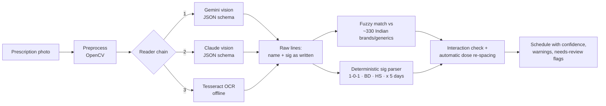
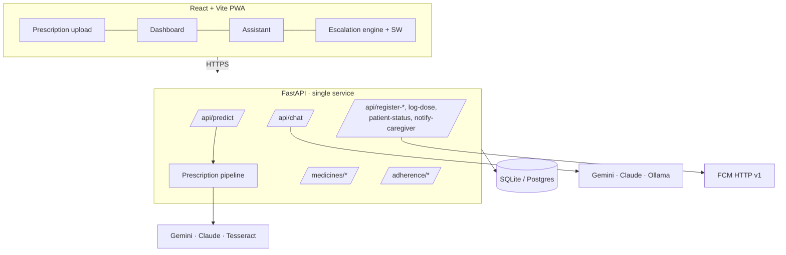

<p align="center">
  <picture>
    <source media="(prefers-color-scheme: dark)" srcset="docs/logo/logo-full-dark.svg">
    
  </picture>
</p>

# PillPulse AI

> **Scan. Verify. Protect.**
> Turn a photo of a handwritten prescription into a verified medication schedule, with reminders that escalate to a caregiver when doses are missed.


| Service | URL |
|---------|-----|
| Frontend | [pill-pulse-172010-rhl4.vercel.app](https://pill-pulse-172010-rhl4.vercel.app) |
| Backend API | Render (FastAPI), interactive docs at `/docs` |

---

## The problem

PillPulse targets India's medication non-adherence problem:

- Only **15.8%** of hypertensive Indians take their medicines correctly
- **69%** of re-hospitalisations are linked to medication non-adherence
- **24%** of handwritten prescriptions are illegible
- **150 million** clarification calls are made every year because of illegible prescriptions

Prescription OCR tools stop at text extraction; reminder apps need everything typed in by hand. PillPulse connects the two: **photo in, safe schedule and reminders out**.

---

## How a prescription becomes a schedule



The design rule: **models only read; code decides.** Vision models transcribe what is written. Everything that affects safety (dose times, duration, quantities, interaction spacing) is computed by deterministic, unit-tested Python, so the same prescription always yields the same schedule.

| Stage | What it does | Where |
|---|---|---|
| Preprocess | Resizes for vision models; for OCR: CLAHE contrast, deskew, denoise, adaptive threshold | `services/prescription/preprocess.py` |
| Reader chain | Gemini → Claude → Tesseract, first available wins, falls through on failure. **If none is configured the API returns 503. It never invents medicines.** | `extractors.py` |
| Drug matching | `rapidfuzz` against a bundled list of ~330 common Indian brands with generic, class and typical use. Misreads like "Azithrall" → Azithral (azithromycin); unknown names are flagged, not dropped. | `drug_db.py`, `data/medicines.csv` |
| Sig parser | `1-0-1`, `½-0-½`, `1-1-1-1`, `OD/BD/TDS/QID`, `q8h`, `HS`, `SOS`, `STAT`, `AC/PC`, empty stomach, `x 5 days`, `5/7`, `2/52`, `1/12`, "morning", dose units (tab/ml/tsp) → clock times based on the patient's own meal times | `sig_parser.py` |
| Safety | ~40 timing/interaction rules (antacid/calcium/iron vs. quinolones, tetracyclines, levothyroxine; warfarin + NSAIDs; SSRIs + tramadol; sildenafil + nitrates…). Absorption conflicts are **re-spaced automatically**; serious combinations are flagged for the doctor. | `interactions.py` |
| Confidence | Combines reader confidence with match score; anything under 75%, unmatched, or with an unclear sig is marked **Please confirm** with the reason | `pipeline.py` |

Try the parser without an image: `GET /api/parse-sig?text=Tab Dolo 650 1-0-1 x 5 days AC`.

---

## Features

**Prescription → schedule.** Upload a photo, review each medicine (matched generic, typical use, the original line as written, confidence, warnings), and add everything to your schedule in one tap.

**Reminders and escalation.**
- Browser/FCM notifications with ✅ Taken · ⏰ Snooze · ❌ Skip
- Repeated skips → caregiver notified on their own device
- Every event (taken/snoozed/skipped/escalated/missed) is stored server-side; a "Taken" tap counts toward adherence
- DEV MODE (bottom-right) runs the whole chain in seconds for demos

**Patient ↔ caregiver.** The patient gets a code (e.g. `JOSH-4521`); a caregiver enters it on their phone and sees the live dose log.

**Dashboard (real data only).** 7-day adherence %, taken vs. missed per day, today's doses with overdue status, next dose, stock and refill warnings, all computed from the schedule and the adherence log in the patient's timezone.

**Assistant.** Answers "when is my next dose", "did I miss anything", "what is Augmentin for", "how many pills are left" from the patient's actual data. It uses Gemini/Claude/Ollama when configured and a rule-based fallback otherwise. Emergency phrases (chest pain, can't breathe, overdose…) are caught by deterministic rules *before* any model and direct the user to 112.

**Symptom checker** with a safety floor: a model can never downgrade red-flag symptoms.

---

## Architecture



> v2 note: the original version ran two backends (Flask for prediction/escalation, FastAPI for medicines) behind one URL, so only half the app could work when deployed, and caregiver links lived in memory and vanished on every restart. Everything is now one FastAPI service with persistent storage, and the routes the frontend already used kept their paths.

---

## Getting started

### Backend

```bash
cd backend
python -m venv .venv
# Windows: .venv\Scripts\activate    macOS/Linux: source .venv/bin/activate
pip install -r requirements.txt
cp .env.example .env        # add at least one reader key (see below)
uvicorn app.main:app --reload
```

Open http://localhost:8000/docs. `GET /api/health` shows which readers and LLM providers are active.

### Frontend

```bash
cd frontend
npm install
cp .env.example .env        # VITE_API_URL=http://localhost:8000
npm run dev
```

App runs at http://localhost:5173.

### Configuration (`backend/.env`)

| Variable | Purpose |
|---|---|
| `GEMINI_API_KEY` | Enables Gemini vision reading + chat (`GEMINI_MODEL`, default `gemini-2.5-flash`) |
| `ANTHROPIC_API_KEY` | Enables Claude vision reading + chat (`ANTHROPIC_MODEL`, default `claude-opus-5-5`) |
| `TESSERACT_CMD` | Path to a Tesseract binary for offline OCR (auto-detected if on `PATH`) |
| `PRESCRIPTION_ENGINES` | Reader order, default `gemini,claude,tesseract` |
| `OLLAMA_URL` / `OLLAMA_MODEL` | Optional local LLM for chat |
| `DATABASE_URL` | Default `sqlite:///./pillpulse.db`; Postgres URLs work |
| `APP_TIMEZONE` | Patient wall-clock timezone, default `Asia/Kolkata` |
| `FIREBASE_SERVICE_ACCOUNT` | Service-account JSON (or path) for FCM HTTP v1 push |
| `CORS_ORIGINS` | Comma-separated allowed origins, default `*` |
| `N8N_BASE_URL` | Optional n8n instance for the workflows in `n8n/` |

---

## API

| Method | Endpoint | Description |
|---|---|---|
| GET | `/api/health` | Status + active readers/providers |
| POST | `/api/predict` | Multipart `image` (+ optional `breakfast`/`lunch`/`dinner`/`bedtime`) → schedule |
| GET | `/api/engines` | Configured reader chain |
| GET | `/api/parse-sig?text=` | See how a dosing instruction is interpreted |
| POST | `/api/register-patient` · `/api/register-caregiver` | Link devices by patient code |
| POST | `/api/log-dose` | Record taken/snoozed/skipped/escalated/missed |
| POST | `/api/notify-caregiver` | Push an escalation to every linked caregiver |
| GET | `/api/patient-status?patientCode=` | Caregiver view of the last 20 events |
| POST | `/medicines/add` · `/medicines/confirm-dose` | Save a medicine (upserts) · mark a dose taken (idempotent per day) |
| GET | `/medicines/today` · `/medicines/remaining` · `/medicines/list` | Today's doses · stock · all medicines |
| GET | `/adherence/score` · `/adherence/weekly` · `/adherence/missed` | Adherence analytics |
| POST | `/api/chat` | Assistant (`session_id`, `message`, `user_id`) |
| POST | `/api/symptoms/start` · `/step` · `/analyze` | Symptom triage |

---

## Testing

```bash
cd backend && pytest -q          # 62 tests
cd frontend && npm run build
```

Tests cover the sig parser (40+ real-world notations, including "dates must not parse as 1-0-1"), fuzzy matching of misspelt handwriting, interaction re-spacing, the full prediction pipeline with a stubbed reader, every patient/caregiver route, adherence maths, idempotent dose confirmation, chat red-flag handling and the symptom safety floor. CI runs both on every push.

Sample prescription photos for manual testing are in [`docs/sample-prescriptions/`](docs/sample-prescriptions/). The research paper and presentation are in [`docs/`](docs/).

---

## Limitations (honest ones)

- **Not a medical device.** PillPulse helps people remember what their doctor prescribed; every result says to confirm with a doctor or pharmacist.
- Messy handwriting needs a vision model (Gemini/Claude). Tesseract handles printed or neat prescriptions only.
- The drug list (~330 entries) and interaction table (~40 rules) cover common Indian prescriptions, not every medicine. Unknown names are flagged rather than guessed.
- Push notifications need a Firebase service account; without one, in-browser notifications and the caregiver dashboard still work.
- Patient codes are not authentication. Anyone with a code can view that dose log. Add real auth before handling real patient data.

---

## License

MIT, see [LICENSE](LICENSE).

<div align="center">
  <strong>💊 PillPulse AI — Scan. Verify. Protect.</strong><br/>
  <em>"Apollo built the highway. PillPulse builds the guardrail."</em>
</div>
